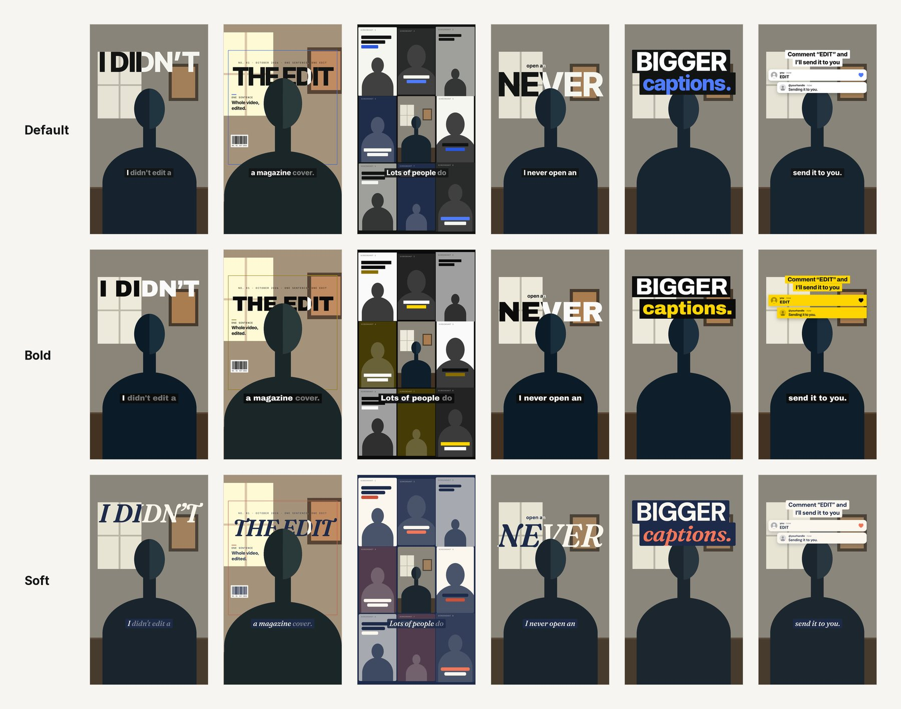
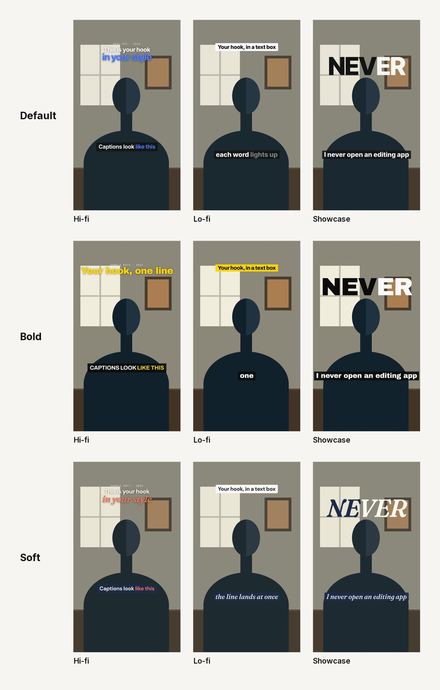
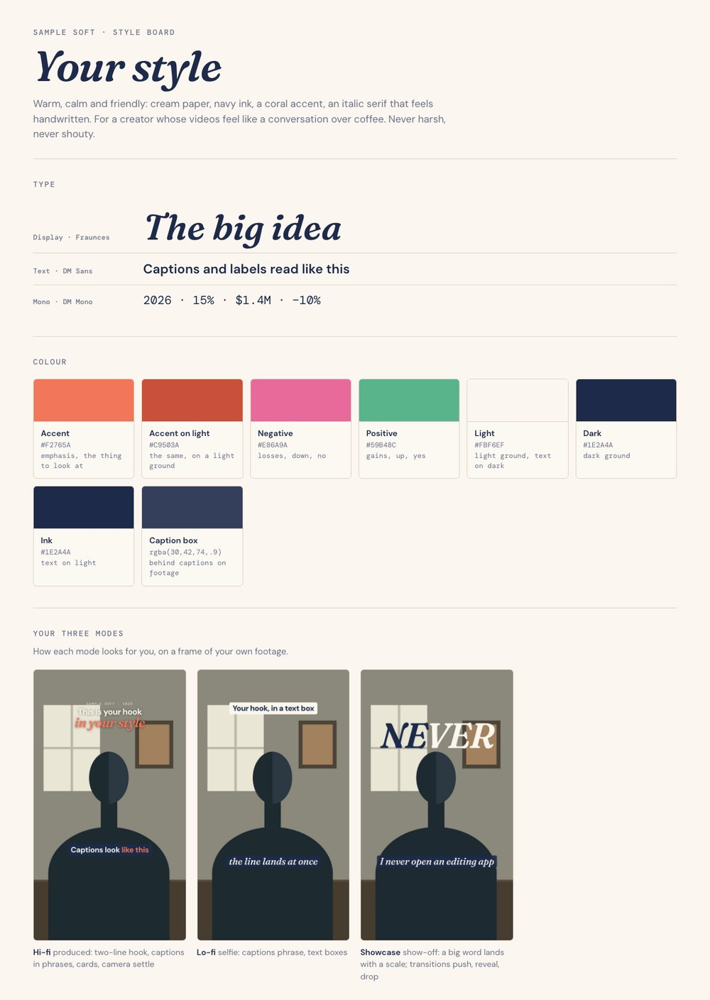
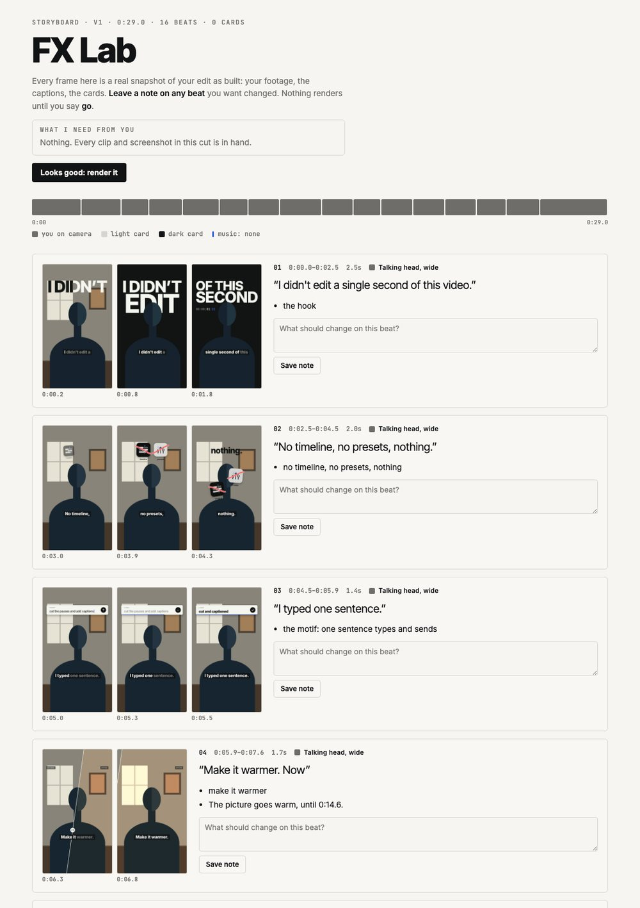

# For Reels
Rocha's Editor Kit (is lit AF)
> [!IMPORTANT]
> **Recommended model:** for best results at the time this repo was published (October 2026), use **Claude Opus 5.5
> on max effort**. In Claude Code, start with `claude --model opus --effort max`. In Claude Cowork, pick Opus 5.5 and
> the highest effort in the model menu. On Codex and ChatGPT Work, use the most capable model at its highest
> reasoning effort.

An AI agent skill that turns one talking-head clip into a finished vertical video, in your own style. Give it a
take; it cuts the edit, writes the captions, builds the motion graphics and lays the sound, then shows you a
storyboard to comment on before anything renders.

Works with Claude Code, Claude Cowork, Codex and ChatGPT Work. Runs on your computer, on your footage. Free and
open source.


<sub>One edit, three style packs. Same cut, same effects, same timing; the look is the pack's. Every image in this
README is drawn on a stand-in figure.</sub>

## What it makes
- A clean edit of one take: dead air out, the last good take of every line, J-cuts on every join, two framings
  from one camera, lip sync checked before and after the render.
- Captions that land on the words, in your fonts and colours.
- Words and numbers behind your head (you stay in front of the type).
- Hand-built motion-graphic cards for the numbers in your script: charts that draw, figures that roll, data kept
  to scale.
- Sound effects under every visual moment, mixed under your voice to streaming loudness (-14 LUFS).
- A storyboard first: every beat with real frames, what moves, what you hear, and what the agent needs from you.
  Leave notes on any beat. Nothing renders until you say go.

## Three modes
- **Hi-fi**: produced. A sit-down take, full-screen data cards, type behind your head.
- **Lo-fi**: selfie. A phone take where you never leave the frame; screenshots and clips land on top of you or
  behind your head, captions light up word by word, native-looking text boxes carry the hook and the call to action.
- **Showcase**: the show-off edit. Every line gets a different hand-built motion graphic the words call for (kinetic
  type, a magazine cover behind your head, a grade that wipes across, a grid of you, a timeline that builds), a
  different transition on every cut, and dense sound. Thirteen effects ship in the library.

Your style decides how each mode edits for you, not just its colours: the hook shape, how captions move, what the
camera does, which transitions you use and how a big word lands all come from your brand and your inspiration.

<p align="center"></p>

## The effects
Thirteen hand-built motion graphics for showcase videos, each one driven by your style pack: kinetic type, a word
stamped behind your head, giant captions, a typing prompt bar, comment threads, a magazine cover, an editing
timeline built from your own video, a grade that wipes across, a grid of you, a frame that recurses into itself,
and more. What each one does and when to reach for it: [`fx/LIBRARY.md`](fx/LIBRARY.md).


## Your style, not ours
The first time you run it, the agent builds your style pack:
1. **Have a brand file?** A brand guide, a DESIGN.md, a PDF or your website. It reads your fonts and colours.
2. **No?** Send 2 or 3 links to videos whose style you like. It studies them: pace, captions, colour, motion.
3. **Neither?** Four quick questions.

Then it shows you a style board: your type and colours, a frame of your own footage in each of the three modes,
and a few cards in your look, and asks if it looks like you. Change anything, any time: "update my style".

The pack lives in `~/reel-kit/style/`, outside the skill, so updates never touch it. Each video keeps a copy of
the style it was made with.

<p align="center"></p>

## Install
It runs on your own computer, on your own footage: a Mac or Linux (Windows is untested; WSL should work) with
ffmpeg, Node 22+ and Python 3.10+. The setup script checks everything, prints the exact fix for anything missing,
and draws a test frame, so READY means it can render.

| Where you use it | Install it | Start it |
|---|---|---|
| [Claude Code](#claude-code) (recommended) | clone into `~/.claude/skills`, run setup | `/for-reels` |
| [Claude Cowork](#claude-cowork) | upload `for-reels.zip` as a skill | ask for For Reels in a Cowork task |
| [Codex](#codex) | clone into `~/.agents/skills`, run setup | `$for-reels` |
| [ChatGPT Work](#chatgpt-work) | upload `for-reels.zip` as a skill | `@for-reels` in a Work task |

Tested end to end in Claude Code and Codex on macOS, and on Linux (ARM). Cowork and ChatGPT Work run the same steps
inside their own sandboxes.

### Claude Code
```sh
git clone https://github.com/RochaStone/for-reels ~/.claude/skills/for-reels
python3 ~/.claude/skills/for-reels/setup/setup.py
```
Then start Claude Code with `claude --model opus --effort max` and type `/for-reels`. To update later:
`git -C ~/.claude/skills/for-reels pull`, then run setup again.

### Claude Cowork
Cowork (the Claude desktop app) runs tasks in a Linux sandbox on your computer that can only reach the folders you
give it.
1. Download `for-reels.zip` from the [latest release](https://github.com/RochaStone/for-reels/releases/latest).
2. In the Claude desktop app: Customize > Skills, then + > Create skill > Upload a skill, and pick the zip.
3. In Settings > Capabilities, turn on code execution and file creation.
4. Make a folder for your videos, for example `reel-kit` in your home folder, and put your clips in it. Start a
   Cowork task, give it access to that folder, and ask: "Use For Reels to make a hi-fi video from my-clip.mov."
5. The first run sets the kit up inside the sandbox: ffmpeg, Node, a render browser and the speech model (a few GB,
   10 to 20 minutes, once). Your style, projects and finished videos are saved in the folder you gave it, so they
   stay on your computer. Renders use the sandbox's processor: slower than Claude Code, same result.

If the sandbox can't install software or reach the internet on your setup, use Claude Code instead.

### Codex
For the Codex CLI, the IDE extension or the Codex tab in the ChatGPT desktop app:
```sh
git clone https://github.com/RochaStone/for-reels ~/.agents/skills/for-reels
python3 ~/.agents/skills/for-reels/setup/setup.py
```
Then type `$for-reels`, or ask Codex to edit your clip with For Reels. Codex runs commands in a sandbox that blocks
the browser the kit renders with, so give the session Full access (the permissions menu in the app, or
`codex --sandbox danger-full-access`); setup tells you if it can't render.

### ChatGPT Work
ChatGPT Work runs in the new ChatGPT desktop app (not ChatGPT Classic) and does its local work through the Codex
built into it.
1. Download `for-reels.zip` from the [latest release](https://github.com/RochaStone/for-reels/releases/latest).
2. In ChatGPT: your profile icon > Skills, then upload the zip. ChatGPT scans uploaded skills and may mark this one
   "Needs review" because it contains code; that's expected.
3. Make a folder for your videos, for example `reel-kit` in your home folder, put your clips in it, and open it in
   a Work task so ChatGPT has access to it.
4. Rendering opens a headless browser, which the Codex sandbox blocks: give the task Full access when it asks.
5. Ask: "@for-reels make a lo-fi video from my-clip.mp4." The first run sets the kit up in that folder (a few
   minutes, once).

Setup creates the kit's own Python environment, downloads GSAP and the render browser, and checks everything
else. All of it goes in `~/reel-kit/` (or the folder you gave Cowork or ChatGPT), next to your style and your
projects, never inside the skill folder. Run it again any time; it only fixes what's missing.

## Make a video
1. Run the skill with your clip, the mode and what it's about:
   `/for-reels hi-fi ~/Videos/take.mov, about this article: <link>`
2. The agent cuts the take, plans every beat, builds the cards, and sends you the storyboard with a list of
   anything it needs from you (a screen recording, a screenshot of your dashboard), or "nothing needed".
3. Leave notes on the storyboard. Send what it asked for. Say go.
4. The finished video and a phone-size copy land next to your clip.

The storyboard opens as a Claude artifact with inline comments when you use Claude, or as a local page on your
computer anywhere else (your notes save to a file the agent reads).

<p align="center"></p>

## Extend it (optional)
Everything above works out of the box with real footage, real screenshots and the kit's own sound effects. Connect
any of these to your agent to go further; the skill uses what it finds and skips what it doesn't.

| Add-on | Unlocks | How |
|---|---|---|
| [Higgsfield](https://higgsfield.ai) MCP | Generated images and video for beats no real footage can show, plus music and sound effects | Add `https://mcp.higgsfield.ai/mcp` as an MCP server or connector and sign in |
| [ChatCut](https://chatcut.io) | Original music for each video and a sound-effects library | Install ChatCut's plugin or connector and sign in |
| [ElevenLabs](https://github.com/elevenlabs/elevenlabs-mcp) MCP | Generated sound effects from a description | Add the official ElevenLabs MCP server with your API key |
| [Suno](https://suno.com), or any track you own | Your own music under the video | Download the track, drop it in the project's `audio/` folder, tell the agent to use it |

Music is off by default. Most creators add a track when they post (Instagram, Edits, TikTok, CapCut), where it
can be a licensed trending sound. Generated images are used sparingly and tagged on the storyboard so you can cut
any of them before the render.

## What's inside
```
SKILL.md              the instructions every agent reads
modes/                hi-fi and lo-fi: how each edit is structured
onboarding/           style setup: ONBOARDING.md, refs.py (studies inspiration videos), board.py (the style board)
pipeline/             cut, transcribe, cutout, build, mix, storyboard, QA, render (Python)
kit/                  the composition's CSS, the card and effect briefs, the style token and style pack references
cards/                the motion-graphic card library (LIBRARY.md), each card driven by your tokens
fx/                   the showcase effects library (LIBRARY.md), each effect driven by your tokens
audio/sfx/            sound effects, synthesized from scratch for this kit (CC0)
storyboard/           the review page and a local server for hosts without artifacts
examples/             a reference edit.py for each mode, and three sample style packs
setup/                setup.py and package.py
dev/                  the kit's own test bench: a drawn stand-in figure, the effects lab, the README images
docs/img/             the README images (dev/readme_shots.py regenerates them)
```

## Who built this

I'm Rocha. Built by a brand strategist, not a tech bro.

I build operating systems that hold a founder's brand so AI transmits it instead of flattening it. Most AI video
tools make everyone look the same. This one only knows how to look like you.

For Reels is that architecture applied to one medium. The same architecture applied to a whole business is the
Conscious Founder Operating System, which I install for founders who'd rather have it built than explained.

If that's the business you're building, come and talk to me. 20 minutes, and bring whatever you're working on.

[Book an exploratory call](https://calendly.com/rochelle-thrivingera/exploratory-call) · [thrivingera.com](https://thrivingera.com) · [@rocheverse](https://www.instagram.com/rocheverse)

## Credits and licenses
For Reels is MIT licensed (see `LICENSE`). It stands on:
- [HyperFrames](https://github.com/heygen-com/hyperframes) (Apache-2.0): renders the video from HTML. Run through
  npx, pinned to one version.
- [GSAP](https://gsap.com) (GreenSock standard license, free): the animation timeline. Downloaded by setup, not
  included here.
- [faster-whisper](https://github.com/SYSTRAN/faster-whisper) (MIT): word-level transcription.
- [Robust Video Matting](https://github.com/PeterL1n/RobustVideoMatting) (GPL-3.0): the optional smoother cutout.
  Its model is downloaded only if you run `setup.py --matte`; none of its code is in this repo.
- Fonts come from [Google Fonts](https://fonts.google.com) (SIL Open Font License), fetched for your pack.
- The sound effects are synthesized by `audio/make_sfx.py` and released CC0.
- The $1 bill in the `dollar-split` card is a US government work in the public domain.
