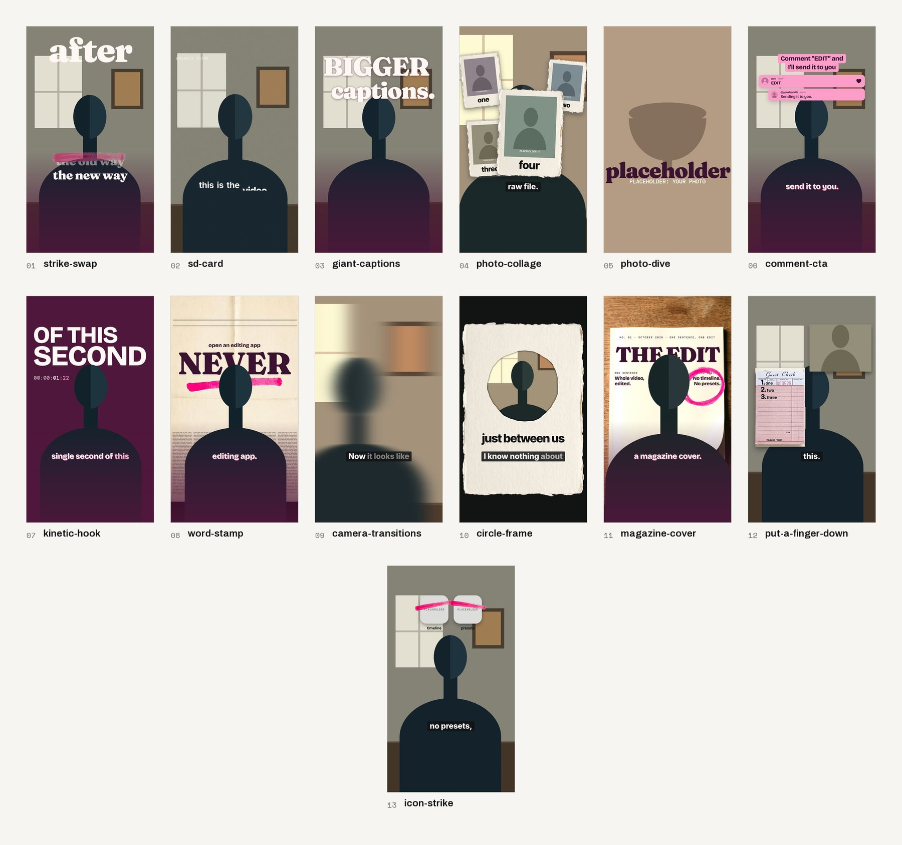

# Effects library (showcase)

Hand-built motion graphics for showcase videos. Every colour and font in them is a token from the creator's style
pack, so each one comes out in the creator's look. A new beat starts from the closest effect: copy its folder to
`<project>/fx/<id>/` (no renaming: `{{ID}}` becomes the id), change the constants at the top of `fx.js` (the words,
the cue words, the labels), and supply what the row says. The contract is `kit/FX_BRIEF.md`; the rules for using
them are `modes/SHOWCASE.md`.

Every effect has a spoken name (the `say` column): the line a creator says that calls for it. Use that name when
talking to the creator; the folder id is for files. A reel uses two or three of these, one of them recurring, not one
per line.

`preview.jpg` in each folder is a frame from the kit's effects lab (a dev tool, not shipped): a drawn stand-in figure (no
real person), the neutral pack, sample words. Placeholders in the effects (icons, headshots, screenshots, clips)
are labelled as placeholders; the creator's real material replaces them.

Every effect passes the material and type rule in `kit/FX_BRIEF.md`: real photographed material (the sheets, cards and
marker strokes in `kit/material`) or type alone, set hard; eases, never bounces; one device per frame.

## Evergreen
These work in any month. Default to these.

| folder | say | layer | what it does | reach for it when the line says | supply |
|---|---|---|---|---|---|
| `giant-captions` | the giant captions | over | the caption line grows out of the caption band into one giant word above the head, a second line rises under it, optional word tiles come up across the chest, the last word lands big and low (a scale ease, no overshoot); one face, the light ink, set hard: no box, no fill, no outline, no coloured shadow; a hard cut out before the window ends | "bigger captions", a payoff line | the words and their cue words; `KARAOKE["hide"]` over the window |
| `word-stamp` | the one word | behind | one emphatic word in the display face, huge, in ink on a photographed sheet of newsprint that cuts in full-bleed behind the speaker with the word (the head breaks it), under the footage's grain; the word stamps letter by letter and holds; a small line sets word by word above it; a real marker underline (a photograph of ink) is drawn under the word on its beat. GROUND = '' puts the word straight over the room instead, light, with an ink copy through mask.png where the picture is light | one emphatic word: never, huge, always, zero | the word, its line, the underline's cue word (UNDER), CENTER_X / Y on the head; GROUND / COLOR; `mkmask.py <project>` rebuilds the mask for the no-sheet version |
| `kinetic-hook` (+ `kinetic-hook-front`) | the opening line | behind + top | the hook: line one in the display face readable on frame 0, the creator's dark ground cuts in as line two stamps letter by letter (the head breaks it), sans lines push through masks on their words over the video's own running timecode (TIMECODE), the last tracks in from wide; optional payoff cuts in; all type set hard, eases only; the front copy carries line one over the speaker for the opening frames, split light/dark by per-frame masks. GROUND swaps the dark plate for a photographed sheet (newsprint) at 60% over the footage under its grain, the type in ink | the first line, a claim about the video itself | the words and the cue word each beat lands on (fx.js constants); GROUND / COLOR for the paper version; `kinetic-hook-front/mkmask.py <project>` rebuilds the masks from clean.mp4; end the front window on the frame the ground cuts in |
| `comment-cta` | the comment keyword close | top | the CTA text box eases in and holds to the end; under it a real comment field types the keyword on the word and posts, the reply card (headshot, handle) answers word by word, a like, the thread folds into the box; optional Follow chip on "follow"; every move an ease, nothing drawn around the UI | the CTA | the keyword, the CTA lines, `HANDLE`, `HEADSHOT`; `FOLLOW_ON` for the chip |
| `photo-dive` | the photo cut | top | the creator's real photo cuts in hard, full-bleed, graded and grained like the footage; a slow eased push into its focus point; one word in the display face, set hard, lands on its syllable and holds; a hard cut back to the speaker at the end. Nothing drawn: no frame, no tape, no caption, no receipt | "I just ordered", "look at this", any line naming a thing there is a photo of | the photo (`photo.jpg`, PHOTO_RATIO, FOCUS = where the push goes), WORD and its cue, CUE in / dive, INK ('ink' on a light photo, 'light' on a dark one); CAMERA punch on the frame after B |
| `photo-collage` | the photo wall | top | the creator's real photos build a collage round the face, one print per key word: each a photo on real handmade paper (a photographed deckled card, its torn edge the paper's own), the footage's grain over it, its word set hard in the paper's margin; each cuts in on its word and settles from a slight push, the hero lands big, all gone on a hard cut | a list of people, places or things there are photos of: "my goddesses", "the team", "the trip" | PHOTOS (file, caption, cue word, layout x / y / w / tilt / hero); the kit's are labelled placeholders; GROUND for the creator's own plain paper under the prints; a CAMERA punch on the hero |
| `camera-transitions` | the camera moves | over | a camera move on every picture cut, keyed on the footage wrapper so timing and zooms are untouched, overscaled so no corner shows; the default cycle is the calm set (push, zoom-through, reveal); whip, spin and drop stay defined for a pack that asks for them; a cut another full-frame effect starts on is left to that effect | every picture cut | nothing: MOVES (which, in order, cycling; the creator's `modes.showcase.transitions`), SKIP, STRENGTH per move |
| `circle-frame` | the peek through | cam | an intimate aside seen through a torn hole in real paper: a sheet of handmade paper (a photographed deckled card with a round hole torn in it by `mkhole.py`) lands on the dark ground with the face whole inside the hole (a synced copy); on the cue word the hole hard-cuts to the real thing the line names (a photo with a slow push, then a clip) and the word lands below it, set hard on the paper; a hard cut back to the full picture | an intimate aside that names a thing they do: "I've been to yoga", "just between us" | the word (WORD), its cue words (CUE, CUE2), FACE and CIRCLE (measured on a still); the creator's photo as still.jpg; `mkhole.py <project> [--clip <b-roll> --src --speed --fx \| --span --cue]` tears the hole and cuts broll.mp4 (the library's photo and clip are PLACEHOLDERS from the stand-in); a CAMERA punch on CUE |
| `put-a-finger-down` | put a finger down | top | the "put a finger down" count: on each spoken point a real photo or screenshot cuts in at the top of the frame (hard-edged, grained like the footage, settling from a push, the last one gone) and the count ticks on a real guest-check pad (photographed, kit/material) sitting lower left, the number in the display face and the point's word beside it, set hard; a hard cut takes it all away | a counted list: "put a finger down if", "three things", "gifts, treats and" | POINTS (photo, the point's word, cue word); the kit's photos are labelled placeholders; PAD and SHOT (where the pad and the photo sit); swap in your own pad or notebook page as pad.jpg; a CAMERA punch per point |
| `magazine-cover` | the magazine cover | behind | a real cover behind the head: a photographed blank cover (gloss, spine, a curled corner) cuts in full-bleed under the footage's grain; the masthead eases in letter by letter in the display face (the head breaks it), a dateline wipes on, coverlines rise through their line masks on the words, all in ink, set hard; a real marker circle (a photograph of ink) is drawn round the key coverline on its word; holds to the hard out (or clears with T.out). Paper, ink and type only: no drawn rules, no barcode, no sticker | "looks like a magazine cover", "the titles" | true masthead and coverlines (constants); LAYOUT measured on a still (baseline about 60 px under the top of the head; RING over the key coverline); a CUT_WINDOWS entry Use when the line calls for it, not as a default. |
| `icon-strike` | the no-apps strike | top | app icons land above the head on their names, a real paint-marker stroke (photographed, kit/material) wipes through each one and it loses its colour, on the last word they drop out of frame and one word rises where they were, set hard | "no X, no Y, nothing" | the words; flat labelled placeholder tiles, or real app icons fetched into the project's copy with `icons.py` (never committed); `INK` light or dark for the footage; a CAMERA punch on FALL_ON Use when the line calls for it, not as a default. |

## This month
Built on formats that were live on Reels 19 to 22 October 2026. Formats like this read as late after about four
weeks; check it is still being posted before you use it, and never make it the only hook in a reel.

| folder | say | layer | what it does | reach for it when the line says | supply |
|---|---|---|---|---|---|
| `strike-swap` (+ `strike-swap-behind`) | the before and after | top + behind | the stacked-lines hook ("X, now Y"): a giant word hangs behind the head (the head breaks it) over one line low in the frame, both set hard in the display face and readable on frame 0; on the turn word a real marker stroke (a photograph of ink) wipes across the giant word and the line; on the new word the giant word cuts out and the new one eases up into place, the line dims and the new line eases in under it; everything holds to the hard out. Optional GROUND on the behind half: a photographed sheet (newsprint) full-bleed behind the speaker under the footage's grain, the words in ink on it | "I used to..., now I...", "yesterday X, today Y", any before/after hook | the words, the turn word and the new word's cue (KEYS) in both fx.js; COLOR (ink on a light sheet); Y / TOP / SIZE measured on a still (the giant word's foot just under the top of the head, the lines under the chin); a CUT_WINDOWS entry for the behind half; a CAMERA punch on the new word; `KARAOKE["hide"]` over the window |
| `sd-card` | lately in my SD card | over | the "Lately in my SD card" trend without the card: the creator's real clips full-bleed, a hard cut on each cue word and a settle from a push, a mono label top left (their handle, a count that ticks per cut) set hard, the line printing on its words along the bottom with the key word in the display face, the footage's grain over everything, a thin cream border at most | a run of moments, "more coming", "dropping details soon", a recap of lately | clips.json (one real clip per segment, the creator's b-roll, and the cue words); `mksd.py <project>` cuts reel.mp4 (the library's clips are PLACEHOLDERS from the stand-in); PHRASE, CUTS_AT, TAG (their handle), BORDER; `KARAOKE["hide"]` over the window; a CAMERA punch at the end |

## Rules that came out of building these
- `hyperframes check` gates the render: every `<video>` needs an id (else it renders frozen), no tweening layout
  props (left, top, letterSpacing: use x / y / scale), no CSS `transform` on an element GSAP tweens, overlap and
  occlusion allowances on the text elements themselves.
- Media timing is written with `{{START+x}}`, `{{SYNC+x}}`, `{{DUR}}` / `{{DUR-x}}` (the build fills them in), so
  a copied effect times itself. Footage copies are frame-identical to the main picture (proven by pixel diff in the
  lab). Hide a copy with opacity, never `visibility`.
- Type over footage splits light/dark against the picture (masks), never an outline. Text fitted after the pack's
  fonts load keeps its fx.html size as a maximum and only shrinks.
- `clip-path` tweens use `fromTo`; a `.to` jumps.
- A snapshot taken exactly on a cut can show the previous frame; check transitions at mid-frame (cut + k/30 + 0.012).
- Generators live next to the effect (`gen.py`, `mkmask.py`, `energy.py`, `icons.py`, `make_grain.py`): rerun them
  when the cut moves. They refuse to write into the library folder itself.
